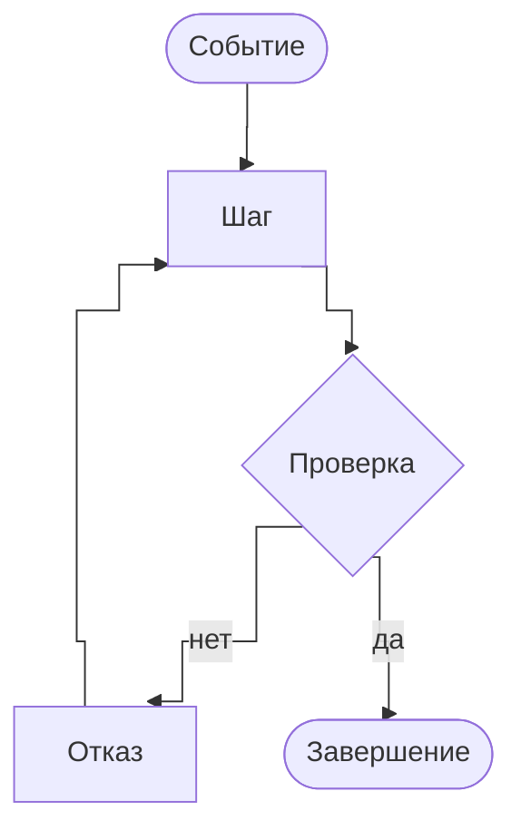
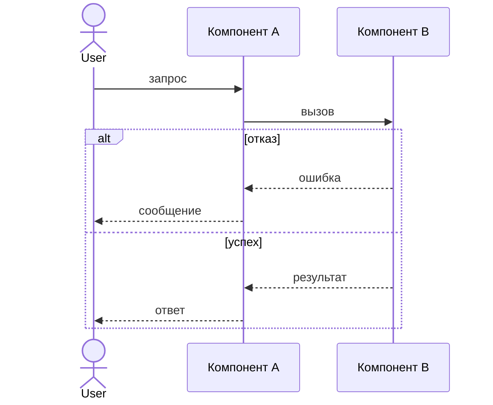
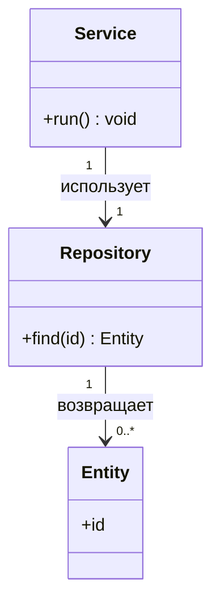
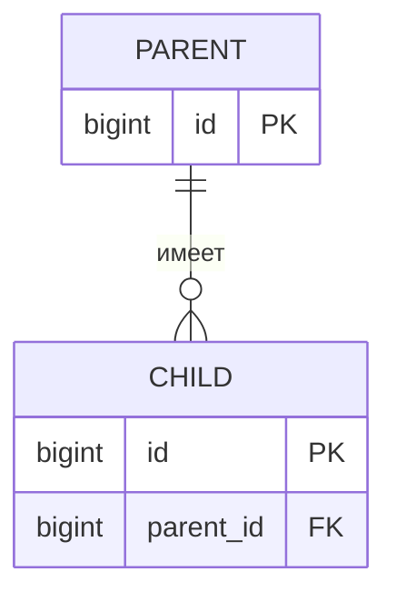

# Таблицы и диаграммы в дизайн-документе

Все схемы живут только в `design.md`. В `spec.md` диаграмм нет: спецификация
описывает поведение, схемы — раздел «как».

Там же, в `design.md`, живут и рабочие таблицы изменения: **изменений**
(файл/класс/метод), **тестов**, **API** и — если изменение добавляет серверное
API — **серверного API**. Это тоже проекция реализации, а не наблюдаемого
поведения, поэтому в `spec.md` их быть не должно. Формат таблиц и правила
согласованности — `references/traceability.md`.

## Обязательный набор

Диаграммы ниже — минимальные образцы синтаксиса, а не эталон содержания.
Подставляй свои участников, шаги и таблицы; показывай ровно то, что описывает
изменение, и не раздувай схему до полной системы.

| Диаграмма | Обязательность | Что показывает |
| --- | --- | --- |
| Процесс (BPMN или `flowchart`/`stateDiagram-v2`) | Всегда | Старт, шаги, ветвления, ошибки, завершение |
| Последовательность (`sequenceDiagram`) | По одному на каждый основной сценарий | Кто с кем и в каком порядке обменивается вызовами |
| Классы (`classDiagram`) | Всегда, если в изменении есть код | Структура классов, связи, кратности |
| Связи таблиц БД (`erDiagram`) | Только если изменение затрагивает схему БД | Таблицы, PK/FK, кардинальность |

Неприменимость оговаривай явно, а не пропускай молча: «ER-диаграмма не
приводится: изменение не затрагивает схему БД».

Отдельная обязательность — таблица серверного API: если изменение добавляет или
меняет HTTP, SOAP, gRPC, GraphQL или иной серверный контракт, она входит в набор
наравне с диаграммами. Формат — `references/traceability.md`, раздел «Таблица
серверного API».

## Диаграмма процессов

Покрывает основной бизнес-процесс изменения целиком.

Минимум, который должен быть виден:

- точка входа (какое событие запускает процесс);
- happy path шаг за шагом;
- хотя бы одна ветка отказа и что происходит после неё (выход, повтор, откат);
- точка завершения.

Правила:

- стрелки только ортогональные, «квадратные»: задавай `curve: 'step'`
  (допустимы `stepBefore`/`stepAfter`) в директиве `%%{init: ...}%%` первой
  строкой диаграммы. Изогнутые и диагональные линии в диаграммах процессов не
  используем;
- одна диаграмма — один процесс; не сваливай в неё всю систему;
- названия узлов совпадают с понятиями из `spec.md`;
- в ветках отказа виден результат, а не просто «ошибка».

Правило про квадратные стрелки относится ко всем диаграммам процессов в
`design.md`, включая `stateDiagram-v2`/BPMN: линии идут под прямым углом, без
скруглений и диагоналей.

## Диаграммы последовательности

По одной на каждый основной сценарий из `spec.md`. Показывай участников и
порядок сообщений, включая ветки ошибок, если сценарий их описывает.

Правила:

- участники — реальные классы/компоненты из таблицы API, не «система» и
  «пользователь вообще»;
- сообщения — методы из таблицы API с их именами;
- `alt`/`opt`/`loop` используй осмысленно: ветка ошибки должна быть видна.

## Диаграмма классов

Показывает структуру и связи. Обязательны кратности и вид связи.

Правила:

- вид связи важен: наследование/реализация (`<|--`, `<|..`), композиция
  (`*--`), агрегация (`o--`), зависимость (`..>`);
- кратности указывай, даже если это `1` — `1`, иначе связь читается как
  «как-нибудь»;
- интерфейсы помечай `<<interface>>`;
- приватные поля можно показать, приватные методы — не обязательно;
- отсутствие связи — тоже информация: не рисуй линию «на всякий случай».

## ER-диаграмма

Только при изменении схемы БД. PK/FK и кардинальность обязательны.

Правила:

- PK и FK помечай явно;
- уникальные ограничения (`UK`) и nullable-колонки тоже полезны;
- имя связи читается как утверждение («имеет», «принадлежит»);
- если схемы БД нет, скажи об этом явно, а не оставляй пустой раздел.

## Согласованность имён

Имена на диаграммах — источник истины наравне с таблицами.

Сверка:

1. Каждый класс на `classDiagram` есть в таблице API.
2. Каждый метод в `sequenceDiagram` есть в таблице API с той же сигнатурой.
3. Каждая таблица/колонка в `erDiagram` совпадает с миграциями и описанием
   данных.
4. Участники сценариев в `spec.md` и на диаграмме называются одинаково.

Если реализация вынужденно отошла от диаграммы — диаграмма обновляется в той же
задаче, что и код. Диаграмма, которая «когда-нибудь догонит код», через неделю
вредит больше, чем помогает.

## Чего избегать

| Анти-паттерн | Почему плохо |
| --- | --- |
| Диаграмма, дублирующая текст спеки | Два источника истины, расходятся |
| Узлы «система», «клиент» без конкретики | Не с чем сверять реализацию |
| Схема без ветки ошибки | Скрывает основной объём работы |
| ER «на будущее» при отсутствии изменений БД | Шум, ложные обязательства |
| Одна мега-диаграмма на всю систему | Нечитаема и не поддерживается |
